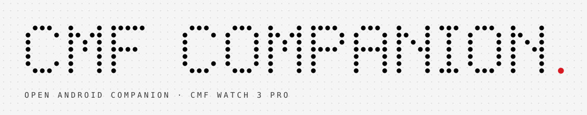

<picture>
  <source media="(prefers-color-scheme: dark)" srcset=".github/assets/banner-dark.svg">
  
</picture>

<br>

> **Built on [CMF-Open](https://github.com/TechJeeper/CMF-Open) by TechJeeper.** Their reverse‑engineering
> and Python `cmfkit` are the foundation this Android app stands on.

```
●  AN OPEN ANDROID APP FOR THE CMF WATCH 3 PRO.  NO ACCOUNT.  NO CLOUD.  ONE CONNECTION.
```

CMF Companion replaces Nothing X on your phone. It holds a single Bluetooth LE link to the
watch from a quiet foreground service, and does the everyday work: notifications, music,
weather, time, find‑my‑phone, watch faces, and small apps that draw on the watch's own
screens. Pairing goes through the watch's factory shell, so there is no Nothing account and
nothing leaves your phone.

<br>

## 01 &nbsp;/&nbsp; WHAT IT DOES

| | Feature | Status |
|:-:|---|---|
| ● | Pair, log in with the stored key, reconnect with backoff | Working |
| ● | Notifications from any app, per‑app allow and mute, calls as "Call: name" | Working |
| ● | Now playing from YouTube, podcasts, Spotify… with play, skip and volume from the wrist | Working |
| ● | Weather from Open‑Meteo, by location or a typed city | Working |
| ● | Time sync on connect, on time‑zone change and every 15 min; battery level | Working |
| ● | Find my phone (rings on silent) and find my watch | Working |
| ● | Watch apps from the CMF‑Open store, run unchanged in a hidden WebView; import your own `.js` | Working |
| ● | Install photo and structured watch faces (`.bin`) | Working |
| ◐ | Watch as a speaker for media, through a pretend phone call | Experiment |
| ○ | Weekly forecast, frequent contacts, health sync to Google Health | In progress |

Tested on a CMF Watch 3 Pro, firmware 1.0.1.77, with a Galaxy Z Fold. The Watch Pro 2 uses
the same protocol and should work.

<br>

## 02 &nbsp;/&nbsp; INSTALL

Grab the latest `cmf-companion-debug` APK from the
[Actions tab](../../actions/workflows/android.yml), or build it:

```sh
git clone --recurse-submodules https://github.com/StoneHub/CMF-Companion
cd CMF-Companion
./gradlew :app:assembleDebug        # needs the Android SDK (ANDROID_HOME or local.properties)
adb install -r app/build/outputs/apk/debug/app-debug.apk
```

Then, on the phone:

```
01  Force-stop or uninstall Nothing X. The watch talks to one phone app at a time.
02  Open CMF Companion. Allow Nearby devices, notification access and background running.
03  Choose your watch and accept the pairing prompt on your wrist. Done; the key is kept.
```

<br>

## 03 &nbsp;/&nbsp; HOW IT'S BUILT

```
protocol/   Pure Kotlin. Framing, AES session, pairing, payloads. No Android deps.
app/        Compose UI, BLE transport, foreground service, notification listener,
            media bridge, weather, watch-app runtime, speaker experiment.
upstream/   git submodule: TechJeeper/CMF-Open (test vectors and the watch-app store).
```

The protocol layer runs on any JDK and is checked byte for byte against vectors from the
Python reference implementation:

```sh
./gradlew -PprotocolOnly :protocol:test
```

Everything the app does is logged on its **Log** tab and in `adb logcat -s CmfCompanion`.

**Power.** One BLE connection, no polling. The service sleeps until the watch, a
notification or a media change wakes it. Weather refreshes every 30 minutes; time syncs
every 15.

<br>

## 04 &nbsp;/&nbsp; STILL TO CONFIRM ON A REAL WATCH

```
○  Music button code map (FFFF:A05D)         see Prefs.buttonCodes
○  Some weather icon ids                       see WeatherSync.condition()
○  Unknown frames on connect                   logged and ignored
○  Speaker mode                                needs the watch allowed for calls in Bluetooth settings
```

If you have a watch and five minutes, open an issue with your Log tab output.

<br>

## 05 &nbsp;/&nbsp; CREDITS

* **[CMF-Open](https://github.com/TechJeeper/CMF-Open)** by TechJeeper: the reverse‑engineered
  protocol, the Python `cmfkit` this app's protocol layer is ported from, and the watch‑app store.
* **[Gadgetbridge](https://codeberg.org/Freeyourgadget/Gadgetbridge)**: its field‑tested CMF notes
  confirmed the weather layout and icon ids. No Gadgetbridge code is included.
* **[Open‑Meteo](https://open-meteo.com)** for free weather data.

<br>

## 06 &nbsp;/&nbsp; LICENSE

MIT, see [LICENSE](LICENSE), for the code written for this app.

`protocol/` is a Kotlin port of TechJeeper's `cmfkit`, and `upstream/` links to their repo,
which has no license file yet. Those parts remain credited to TechJeeper; if they publish a
license, it applies to them, and if they'd like anything changed here, just open an issue.

CMF Companion is an independent project. It is not made, endorsed or supported by Nothing
Technology Limited. "CMF" and "Nothing" are their trademarks, used here only to say which
watch this works with.

<br>

<p align="center"><code>● ● ●</code></p>
